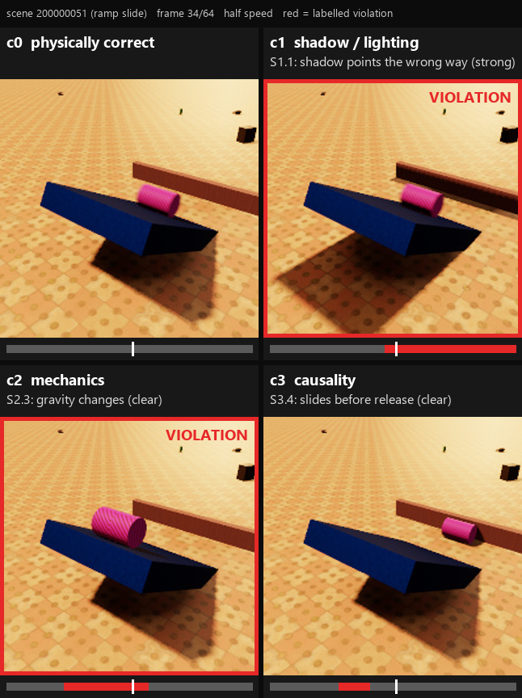

# Pilot dataset card (milestone M1)

## What this is

The pilot is the first full run of the generator described in the design document. Every scene is
simulated once without any violation (c0), and then up to three times more with exactly one
violation injected: a shadow or lighting error (c1), a mechanics error (c2), or a causality error
where an effect starts before its cause (c3). A training pair is always a c0 clip and one violating
clip from the same scene, so the only difference between the two clips is the violation itself.
Before the labelled onset the two clips are byte-for-byte identical.

The pilot follows the M1 scope from the roadmap: static camera, procedural primitive objects, and
three scenario families (free fall, ramp slide, billiards), plus one held-out family (projectile into
a bin) that only appears in an out-of-distribution test split.

*One test scene (ramp slide) in its four versions at frame 34. The red frames and the red parts of the
timelines mark the labelled violation intervals: c1 and c2 are active here, the c3 interval (frames 18
to 25) is already over. The full clip is in `04_demo_c0_c1_c2_c3.mp4`.*

## How a sample is made

1. A scene seed fixes everything: scenario, objects, materials, floor, environment map, light and camera.
2. PyBullet simulates the compliant version (240 Hz recorded, 960 Hz solver).
3. The violation is injected. For c1 only the shadow light or the shadow casters change and the
   motion is the c0 motion. For c2 the simulation is edited at the onset and then left to run
   normally. For c3 the affected objects are moved earlier in time by 4 to 14 frames.
4. The clip is rendered by a GPU rasterizer with its own shadow pass (or by Blender Cycles for the
   renderer test split). Frames before the change are copied from c0.
5. The onset label is the first frame whose pixels differ from c0; the offset comes from the
   injector. Clips that fail a validity or visibility check are rejected and redrawn.

## Size

| | Scenes | Clips | Pairs |
|---|---|---|---|
| Total | 2,930 | 10,290 | 7,360 |
| Train | 1,900 | 6,834 | 4,934 |

Clips per split and class (c0 is the compliant clip; a scene does not always yield all three
violation classes, for example c3 only exists where there is a cause and an effect):

| Split | c0 | c1 | c2 | c3 | What is different |
|---|---|---|---|---|---|
| train | 1,900 | 1,877 | 1,817 | 1,240 | |
| val | 200 | 196 | 193 | 128 | new seeds |
| test_id | 200 | 200 | 192 | 141 | new seeds |
| test_ood_objects | 150 | 147 | 139 | 103 | unseen shape family (capsules) |
| test_ood_env | 150 | 147 | 141 | 99 | unseen floor textures and environment maps |
| test_ood_scenario | 150 | 150 | 140 | 0 | unseen scenario (projectile into a bin) |
| test_ood_subtype | 150 | 113 | 113 | 0 | unseen violation subtypes (S1.5, S2.7) |
| test_renderer | 30 | 30 | 30 | 24 | 30 test_id scenes re-rendered in Blender Cycles |

Clip format: 64 frames at 24 fps (2.7 s), 224 x 224 RGB, JPEG quality 95 in WebDataset tar shards.
Total size 16.1 GB (1.6 MB per clip).

## Violations

| Class | Subtype | Pairs | | Class | Subtype | Pairs |
|---|---|---|---|---|---|---|
| c1 | S1.1 shadow points the wrong way | 727 | | c2 | S2.1 objects pass through each other | 373 |
| c1 | S1.2 shadow drifts off the object | 675 | | c2 | S2.2 push with no contact | 751 |
| c1 | S1.3 frozen shadow | 473 | | c2 | S2.3 gravity changes | 737 |
| c1 | S1.4 wrong shadow length | 669 | | c2 | S2.4 stops in mid-air | 149 |
| c1 | S1.5 shadow moves the wrong way (OOD only) | 113 | | c2 | S2.5 bounces too high | 198 |
| c1 | S1.6 wrong shadow blur | 203 | | c2 | S2.6 masses swapped | 181 |
| c3 | S3.1 target moves before it is hit | 851 | | c2 | S2.7 spins with no torque (OOD only) | 113 |
| c3 | S3.4 object slides before it is released | 884 | | c2 | S2.8 friction changes | 263 |

Severity: 2,416 subtle, 2,961 clear, 1,983 strong. The levels do correspond to how much of the image
changes: the median violating clip changes 1.3% (subtle), 1.8% (clear) and 2.9% (strong) of its
pixels at the most visible frame.

Timing: 2,399 persistent (the violation lasts to the end), 2,853 transient (it stops again) and
2,108 event-based (phase-through, causality), so the end of a clip is not a cue.

Onsets are spread the same way for all three classes (mean frame 30, range 12 to 57), so the position
of the onset does not give the class away. Interval lengths do differ by class, mostly by design:
c3 intervals are short by definition (median 10 frames), c1 intervals are longer (median 24 frames).

## What varies

- Objects: on average 1.9 moving objects and 2.5 static distractors per scene. Shapes are spheres,
  cylinders, boxes, wedges, bricks and random convex hulls (capsules are held out). Sizes 5.6 to
  19.4 cm (5th to 95th percentile), masses 0.01 to 5.5 kg.
- Materials (foam, wood, plastic, rubber, metal) set density, friction and restitution. The look of an
  object is drawn independently of its material, so appearance does not reveal mass or bounciness.
- Appearance: 48 floor textures and 40 environment maps from Poly Haven, 37 real object textures and
  48 generated patterns; round objects always carry a pattern so that spin is visible.
- Camera: static in the pilot, field of view 36 to 54 degrees, 16 to 43 degrees below horizontal,
  framed automatically on the action. Key light elevation 28 to 73 degrees, colour temperature
  3,500 to 7,500 K, soft to hard shadows.

## Labels

Every clip comes with `onset_frame` and `offset_frame` (half-open interval), a per-frame 0/1 label and a
per-frame class, plus subtype, severity, timing, the objects involved and the exact injection
parameters. Each scene's full configuration is stored, so any clip can be regenerated from its seed
and the recorded generator commit.

## Quality checks

The `validate` command found no errors in the final data (10,290 clips): labels are consistent with
onsets and offsets, every clip has 64 frames, and in every pair the stored frames before the onset are
byte-identical. During generation 303 scene drafts were rejected because the objects would have been
too small on screen, 14 because of interpenetration above 5 mm, and 2,230 violation drafts because they were too
faint to see; those were redrawn. The shortcut audit is written up separately (`03_shortcut_audit`).

## Known limitations

- Subtype frequencies are uneven: S2.4, S2.5 and S2.6 need specific situations (an object in the air,
  a bounce, a collision) and appear 4 to 5 times less often than the common subtypes. The
  balancing fix is planned before M2.
- c3 only exists in billiards and ramp scenes, so in a 4-class setting the scenario says something
  about whether c3 is possible.
- Mass inconsistency (S2.6) is hard to see in principle when no earlier collision reveals the masses.
- In c3 the cause object still reacts at the true contact time, as the design document warns.
- All clips are synthetic and rendered with a fairly simple rasterizer; the 30-scene Blender subset is
  the only check against a second renderer so far.

## Provenance and licences

Generated with physgen 0.1.0 at commit 59bfd1e (Blender subset at 666f303; the generator code is
the same), asset manifest f54d6907c8ea. 2,900 raster scenes took 62 minutes on a Ryzen 5 5600 with a
GTX 1050 Ti (about 7,000 pairs per hour); the Blender subset took about 2.7 minutes per scene.
Textures and environment maps are Poly Haven (CC0); generated patterns are CC0.
